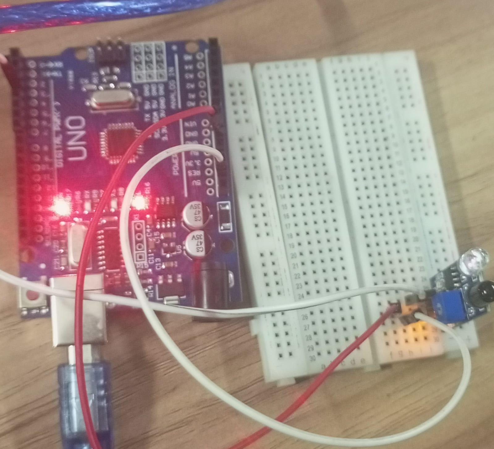

# IR-sensor
IR Sensor – Obstacle Detection 

# About
A simple Arduino project that uses an IR sensor to detect obstacles. It displays "1" when no obstacle is detected and "0" when an obstacle is detected on the Serial Monitor.

# Components Required
- Arduino Uno
- IR Sensor Module
- Jumper Wires
- Breadboard

# Working
1. The IR sensor emits infrared light.
2. When an obstacle is nearby, the reflected IR light is detected.
3. Arduino reads the sensor's digital output.
4. No obstacle detected → "1"
5. Obstacle detected → "0"

# Output

# Arduino Code
[View Arduino Code](./ir.ino)

# Learning Outcome
Learned how to interface an IR sensor with Arduino, read digital inputs, and detect nearby obstacles.
